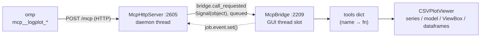

# TODO — logplot MCP server（外部 agent 控制介面）

狀態：**Phase 1 完成並上線**（2026-10-08；omp 已接線，實測通過）。Phase 2 / 3 待做。

目標：讓外部 agent（omp）透過 MCP 直接驅動**執行中**的 logplot GUI —— 載入 log、查值、繪圖、跳時間點。不在 UI 內養對話框、不管 LLM key。

## 已定案的決策

| 項目 | 決定 | 理由 |
|---|---|---|
| 傳輸 | **MCP Streamable HTTP**，只 bind `127.0.0.1:8790` | 要驅動使用者眼前那個 GUI 實例；stdio 由 client 另啟子行程，會變成第二個無 GUI 的 logplot |
| 依賴 | **零新依賴**（stdlib `http.server` / `json` / `threading`）| PEP 723 inline block 與 PyStand runtime 是兩套世界，加 `mcp` SDK 要同步兩處，且 pydantic-core/httpx/anyio/uvicorn 都得進 `build.py` 的打包分流 |
| 程式碼位置 | **全部留在 `logplot.py` 內** | `update_script()` 只替換 `sys.argv[0]`，另開模組不會被更新機制帶到 |
| 執行緒 | HTTP 跑 daemon thread；工具呼叫 marshal 回 GUI thread | `self.series` / `self.model` / ViewBox 只能在 GUI thread 觸碰 |
| 埠預設 | **啟動即開 8790**，`--mcp-port PORT` 換埠、`--mcp-port 0` 關閉 | 使用者慣用的啟動方式即可用，不必每次記旗標 |
| 認證 | 可選 Bearer token：`--mcp-token` 或 `$LOGPLOT_MCP_TOKEN`；**不寫進任何檔案** | repo 公開；`%TEMP%` 的探索檔是世界可讀的 |
| 破壞性工具 | **永久不開放** | `remove_all_files` / `remove_file` / `save_state` / `load_state` / `update_script` |
| headless / stdio 模式 | **不做**（2026-10-08 決定） | 需求是驅動 GUI，不是無頭批次 |
| omp 設定位置 | **用戶層 `~/.omp/agent/mcp.json`** | 任何 cwd 都生效；不動公開 repo 的檔案 |
| 已放棄路線 | UI 內建對話 agent（openai SDK + `QDockWidget` + 本機 llama.cpp） | 需在 UI 養對話框、管 key、加依賴；MCP 路線同樣能達到目的且零依賴 |

## 既有程式碼的硬限制

1. **單檔 + 自動更新**：新功能必須寫進 `logplot.py`。
2. **依賴有兩套世界**：PEP 723 inline block（`uv run` 用）與 `build.py` 打包的 `D:\log_tools\runtime\Lib\site-packages`（PyStand 用）必須同步。目前兩邊都只有 PySide6 / numpy / pandas / zstandard（runtime 無 pyarrow，`load_csv_files` 會自動退回 C engine）。
3. **Qt 物件只能在 GUI thread 觸碰**：`self.series`、`self.model`、`main_vb` 皆為主執行緒狀態。
4. **不要掛進高頻路徑**：`mouse_moved`（:1427）→ `update_crosshair`（:1435）每次滑鼠移動都跑，agent 狀態更新不得插入此路徑。

## 架構



- 常數：分類門檻 `logplot.py:47-48`、MCP 預設 `:53-59`。放在 `VERSION` 之後是必要的——`--mcp-port` 的預設參數在 class 定義時求值。
- `SeriesState.kind` :119（快取的分類）、`_json_value` :2182 與 `_segment_starts` :2191（時間視窗表示法）、`McpBridge` :2209 / `McpHttpServer` :2605。
- `CSVPlotViewer.start_mcp_server()` :2103 負責生命週期，`main()` :2754 解析 `--mcp-port` / `--mcp-token`，在 `window.show()` 後啟動。

## 已實作

| 項目 | 實作 |
|---|---|
| 協定 | 手寫 JSON-RPC 2.0 的 MCP Streamable HTTP 子集：`initialize`（echo client 版號，支援 2024-11-05 / 2025-03-26 / 2025-06-18）、`notifications/initialized`（202 空 body）、`ping`、`tools/list`、`tools/call`。`GET /mcp` 回 405（讓 client 靜默停用背景 SSE listener）；不做 SSE 串流 |
| 執行緒 | HTTP daemon thread；`_McpJob(name, args, event, result)` 經 `McpBridge.call_requested`（`Signal(object)`，跨執行緒自動 queued）送進 GUI thread，HTTP thread 以 `Event.wait(60s)` 等結果；逾時回 `isError` |
| 認證 | 有 token 時檢查 `Authorization: Bearer`，不符回 401 |
| 探索 | 啟動時寫 `%TEMP%\logplot-mcp.json`（`url` / `port` / `auth` / `pid`，**不含 token**），`closeEvent` 時刪除 |
| 開放的唯一工具 | `load_files`（idempotent：已載入的檔案不重讀、不長出重複樹節點；非字串路徑列進 `failed` 而非靜默忽略）|
| UI 回饋 | Help 選單顯示 `MCP Server: 127.0.0.1:8790 (token required / no auth)`；狀態列訊息；使用說明（F1）有對應段落 |

omp 端（用戶層 `~/.omp/agent/mcp.json`）：

```json
"logplot": {
  "type": "http",
  "url": "http://127.0.0.1:8790/mcp",
  "timeout": 120000,
  "enabled": true
}
```

`timeout` 用 120 s（預設 30 s 太短：載入大型 `.zst` 走 C engine 會超過 30 s），且必須大於 server 端 60 s 的 GUI 等待上限，才會由我們回報明確錯誤而不是 omp 端先斷線。

### 驗證紀錄

- 協定層：401（無 token）、initialize / ping / tools/list / tools/call、未知方法 `-32601`、壞 JSON 400 `-32700`、`GET /mcp` 405、`closeEvent` 後埠停止並刪除探索檔 —— 全部對部署環境 `D:\log_tools\runtime\python.exe` (3.13.3) 實測。
- 端到端：`OMP_MCP_REQUIRE_READY=1 omp -p --no-session --mode json "…"` → omp 在 discovery 階段連上，工具以 `mcp__logplot_load_files` 掛載（`details.xdev.inner.serverName == "logplot"`），回傳的是執行中 GUI 的真實狀態。
- 真實資料：`log-20260101.log_mpc_ctrl_105.csv.zst` → 328,746 列 × 125 欄，2025-12-31 23:00:03 ~ 2026-01-01 20:29:03 (UTC+8)。
- 分類（`kind`）：邊界逐一驗證 —— 字串 14 → `enum`、15 → `text`；數值 2 → `enum`、3 → `analog`；全 NaN → `enum`。8 個 fixture 勾選後的實際落點（`second_vb` / `main_vb` / 不畫）與 `kind` 全部相符，字串 `enum` 才建立 `text_mapping`。真實 125 欄檔案 `kinds` 分佈 enum 73 / analog 51 / text 1，與另一支獨立量測的 distinct 計數一致。
- Phase 2 時間視窗：26 列的 fixture 逐項驗證 —— 階梯訊號的變化清單 `[[t0,0],[t0+3,1],[t0+7,2]]`、單樣本/空視窗/不落在樣本上的視窗、全空白欄回 `[[t0, null]]`、物件欄的連續空白收斂成一段、`max_points` 觸發 `dense`、字串 `dense` 的值分佈含空白且正確截斷、`find_changes` 的逐欄次數（含 `limit` 截斷）與四種參數錯誤訊息。所有 payload 都用**拒絕 `NaN`/`Infinity` 的嚴格 JSON parser** 解析過。
- Phase 2 真實檔案交叉比對：`find_changes` 全檔（328,746 樣本 × 125 欄）**729 ms / 10.5 KB**、1 小時 **37 ms**；`unchanged_series = 34` 與獨立量測一致，`alarm_data` 47、`mpc_ctrl_t_play` 280,140、`t_elapsed` 280,140、`pos_1` 257,490、`mpc_ctrl_mode` 333、`st_1` 922 全部吻合。`get_window` 1 小時：`mpc_ctrl_mode` 18 段 / 0.82 KB / 1.9 ms、`mpc_ctrl_cali_1` 1 段、`alarm_data` 1 段（整小時空白）、`t_elapsed` 走 `dense`（15,074 段略去，0.50 KB）。
- 這輪在真實資料上抓到兩個 fixture 沒涵蓋的缺陷：物件欄的 NaN 被當成「每樣本都變」（`alarm_data` 誤報 324,428 次，實際 47 次）、以及 `to_numpy()` 把 4,100 萬個元素裝箱成 object 陣列導致全檔掃描要 2.7 s（改為逐欄 `shift()` 比較後 0.73 s）。
- Phase 2 工具：`list_files` / `list_series` 以四種檔案寫法（完整路徑 / basename / 反斜線 / 全小寫）呼叫皆命中；未知檔回錯誤並列出已載入檔案；400 欄不截斷、500 欄截斷成 400 並標 `truncated`；`plotted` / `labels` / `text_tracked` 以臨時腳本驅動真實 `CSVPlotViewer` 驗證（數值曲線、2 值的分類字串、20 值的字串只追蹤不繪圖、改名後的 label、空欄位省略）。

## 工具清單（每項對應既有 method）

| 工具 | 接到哪裡 | 狀態 |
|---|---|---|
| `load_files(paths)` | `load_csv_files`（:927） | ✅ Phase 1 |
| `list_files()` | `dataframes` → 逐檔 rows / columns / start / end | ✅ Phase 2 |
| `list_series(file?)` | `dataframes` + `series` + `active_text_series`：名稱分 numeric / string，附 `plotted` / `text_tracked` / `labels` / `kinds`（不回數值） | ✅ Phase 2 |
| `find_changes(t1, t2, file?)` | 逐欄 `shift()` 比較，回有變化的訊號與次數（忙的在前）；篩選層 | ✅ Phase 2 |
| `get_window(file, column, t1, t2, max_points?)` | 變化清單（精確 RLE），超出預算則轉 `dense` 摘要 | ✅ Phase 2 |
| `search_text(q)` | `search_input.setText` + `search_global_text()`（:1923） | Phase 2 |
| `get_view_range` | `main_vb.viewRange()` | Phase 2 |
| `plot_series` / `unplot_series` | `column_item.setCheckState()` → `on_item_changed`（:1056） | Phase 3 |
| `zoom_to(t1, t2)` | `main_vb.setXRange` + 自動算 y 範圍 | Phase 3 |
| `compute_series(file, col, mode)` | `create_computed_series`（:1321，`1` / `2` / `"abs"`） | Phase 3 |
| `set_timezone(off)` | `set_timezone_offset`（:821） | Phase 3 |
| `measure_delta` | `measure_line{1,2}.value()`（`update_measure_label` :1754） | Phase 3 |
| `screenshot_plot` | `plot_widget.grab()` → MCP image content（僅 vision 模型有用） | Phase 3 |

### 工具參數慣例

- 檔案識別一律用 `file`（值為 `list_files` 回報的完整路徑），輸出也用 `file` 當鍵。
- `McpBridge._resolve_file()` 依序嘗試：完全相符 → `normcase(abspath())` 正規化比對（大小寫 / 斜線差異可通過）→ 唯一 basename；都不中就報錯並列出已載入的檔案。
- 訊號識別一律用 `column`，值取自 `list_series` 的 `numeric_series` / `string_series`。
- `list_series` 每檔上限 `MCP_MAX_SERIES_PER_FILE`（400）個名稱，超過時 `truncated: true` 並附 `series_count`；空欄位（`text_tracked` / `labels`）直接省略。
- 時間一律 Unix 秒（UTC, float）。
- `kinds` 是 viewer 自己的繪圖分類，由 `SeriesState.kind` 單一來源計算並記憶：`enum`（右軸車道，distinct 少）／`analog`（主軸）／`text`（自由文字，只追蹤不畫）。門檻為 `STRING_TEXT_THRESHOLD`(15) 與 `NUMERIC_ENUM_THRESHOLD`(3)，兩個數值不再內嵌於勾選路徑。
- 注意：`list_series` 第一次讀一檔會替每欄做一次全欄 distinct 計數（125 欄實測約 0.5 s，在 GUI thread），之後由 `SeriesState` 快取（1.4 ms）。勾選路徑因此不再重算。
- **時間視窗的表示法（`find_changes` / `get_window` 共用）**：變化清單 `segments: [[t, value], …]`，值的有效範圍**到下一段為止**（最後一段到 `t2`），頭尾相連故不重複 `t_end`。區間是雙端閉區間；`t ≥ 1e11` 沿用 `search_by_timestamp` 的規則視為 ns。
- **`get_value` 已決議不做**：單點查值對診斷沒有意義（人看的是變化），改由 `find_changes`（篩選）+ `get_window`（變化清單）覆蓋。
- `get_window` 的 `mode`：`segments`（段數 ≤ `max_points`，零資訊損失）／`dense`（超預算，改回 `stats` + `extremes`，字串欄改回值的分佈含空白）。`max_points` 預設 `MCP_MAX_WINDOW_POINTS`(500)、上限 `MCP_WINDOW_POINT_CAP`(5000)。
- **空白（NaN）對空白算「沒變」**：物件欄與數值欄都一樣。`_segment_starts()` 用 `pd.isna` 做這個遮罩；輸出時 NaN 一律轉 `null`（`_json_value`），確保 payload 是合法 JSON（不含 `NaN` 字面值），數值為 0 或空陣列時也不會誤判。

## 待辦

- [ ] **Phase 2 — 唯讀工具**（`list_files` / `list_series` / `find_changes` / `get_window` 已完成）：`search_text` / `get_view_range`
- [ ] **Phase 3 — UI 操作工具**：`plot_series` / `unplot_series` / `zoom_to` / `compute_series` / `set_timezone` / `measure_delta` / `screenshot_plot`

每階段可獨立 smoke test，不必等全鏈路完成。

## 風險

- [ ] **context 爆掉**：工廠 log 動輒百萬列，工具永遠不回傳原始 df，只回聚合摘要與下採樣點。
- [ ] **tool schema 精簡**：模型對巢狀 object 與 enum 耐受度低，schema 手寫成扁平 `string` / `number` / `boolean`。
- [ ] **GUI 阻塞**：GUI 開著 modal dialog 時工具會卡住，靠 `Event.wait` 逾時回錯（60 s）。HTTP 本身已在 worker thread。
- [ ] **omp 會改寫字串參數**：omp 送出前會把字串值中「像內部 URL」的（含 `local://`、file-backed 內部 URL）換成實際檔案路徑，所以參數驗證要以改寫後的 payload 為準。另 `i` 欄位會被剝除。
- [ ] **埠衝突**：第二個實例 bind 失敗只印 `[mcp] could not listen on 127.0.0.1:8790`，程式照常運作，不會影響正在跑的那個。
- [ ] **PyStand 版落後**：`D:\log_tools\logplot.exe` 與 `D:\log_tools\logplot.py` 是先前部署的副本，沒有 MCP；要走 exe 得重打包（`build.py`），或先用 `logplot.bat`。
