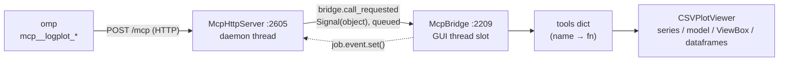
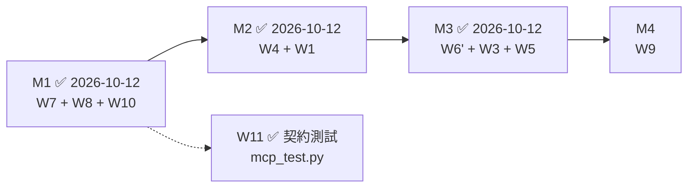

# TODO — logplot MCP server（外部 agent 控制介面）

狀態：**Phase 1 完成並上線**（2026-10-08；omp 已接線，實測通過）。**Phase 2 唯讀工具**（`list_files` / `list_series` / `find_changes` / `get_window`）已上線。**Phase 2.5 計畫修訂**（2026-10-09：suggest.md 兩輪評價 × 五份真實 log 實測）已成文。**M1 完成**（2026-10-12：W7 家務與語意修正、W8 背壓、W10 載入透明度、W11 契約測試）。**M2 完成**（2026-10-12：W4 `mode="summary"`、W1 `list_series detail`）。**M3 完成**（2026-10-12：W3 多欄與快照、W5 `mode="aggregate"`、W6' `find_text`；覆議點 1 與 3 分別以「覆蓋」與「開放」結案），只剩 M4。

目標：讓外部 agent（omp）透過 MCP 直接驅動**執行中**的 logplot GUI —— 載入 log、查值、繪圖、跳時間點。不在 UI 內養對話框、不管 LLM key。

## 已定案的決策

| 項目 | 決定 | 理由 |
|---|---|---|
| 傳輸 | **MCP Streamable HTTP**，只 bind `127.0.0.1:8790` | 要驅動使用者眼前那個 GUI 實例；stdio 由 client 另啟子行程，會變成第二個無 GUI 的 logplot |
| 依賴 | **零新依賴**（stdlib `http.server` / `json` / `threading`）| PEP 723 inline block 與 PyStand runtime 是兩套世界，加 `mcp` SDK 要同步兩處，且 pydantic-core/httpx/anyio/uvicorn 都得進 `build.py` 的打包分流 |
| 程式碼位置 | **全部留在 `logplot.py` 內** | `update_script()` 只替換 `sys.argv[0]`，另開模組不會被更新機制帶到 |
| 執行緒 | HTTP 跑 daemon thread；工具呼叫 marshal 回 GUI thread | `self.series` / `self.model` / ViewBox 只能在 GUI thread 觸碰 |
| 埠預設 | **啟動即開 8790**，`--mcp-port PORT` 換埠、`--mcp-port 0` 關閉 | 使用者慣用的啟動方式即可用，不必每次記旗標 |
| 認證 | 可選 Bearer token：`--mcp-token` 或 `$LOGPLOT_MCP_TOKEN`；**不寫進任何檔案** | repo 公開；`%TEMP%` 的探索檔是世界可讀的 |
| 破壞性工具 | **永久不開放** | `remove_all_files` / `remove_file` / `save_state` / `load_state` / `update_script` |
| 唯一契約 | **只假設 CSV 與第一欄是 timestamp**；不得內建任何 payload 文法或值語意 | 實務上格式與形態繁多（見 Phase 2.5 五檔實測）；依「看過的 log 內容」寫死的解析，下一批 log 就失效 |
| 語意來源 | 使用者載入的 SignalList（`display_name`）或呼叫端參數；伺服器只回結構事實 | 同上 |
| `kind` 的角色 | **僅描述 viewer 怎麼畫**，不作為輸出策略的依據；不以基數自動重判 enum / code | `AI_W1`=〔0,1,16,17,256,272,273〕、`SVOHR1`=〔0,18615…18623〕與 `mpc_ctrl_state`=〔1,2,7,8,9,10,12〕結構上不可分 |
| headless / stdio 模式 | **不做**（2026-10-08 決定） | 需求是驅動 GUI，不是無頭批次 |
| omp 設定位置 | **用戶層 `~/.omp/agent/mcp.json`** | 任何 cwd 都生效；不動公開 repo 的檔案 |
| 已放棄路線 | UI 內建對話 agent（openai SDK + `QDockWidget` + 本機 llama.cpp） | 需在 UI 養對話框、管 key、加依賴；MCP 路線同樣能達到目的且零依賴 |

## 既有程式碼的硬限制

1. **單檔 + 自動更新**：新功能必須寫進 `logplot.py`。
2. **依賴有兩套世界**：PEP 723 inline block（`uv run` 用）與 `build.py` 打包的 `D:\log_tools\runtime\Lib\site-packages`（PyStand 用）必須同步。目前兩邊都只有 PySide6 / numpy / pandas / zstandard（runtime 無 pyarrow，`load_csv_files` 會自動退回 C engine）。
3. **Qt 物件只能在 GUI thread 觸碰**：`self.series`、`self.model`、`main_vb` 皆為主執行緒狀態。
4. **不要掛進高頻路徑**：`mouse_moved`（:1427）→ `update_crosshair`（:1435）每次滑鼠移動都跑，agent 狀態更新不得插入此路徑。

## 架構



- 常數：分類門檻 `logplot.py:47-48`、MCP 預設 `:53-59`。放在 `VERSION` 之後是必要的——`--mcp-port` 的預設參數在 class 定義時求值。
- `SeriesState.kind` :119（快取的分類）、`_json_value` :2182 與 `_segment_starts` :2191（時間視窗表示法）、`McpBridge` :2209 / `McpHttpServer` :2605。
- `CSVPlotViewer.start_mcp_server()` :2103 負責生命週期，`main()` :2754 解析 `--mcp-port` / `--mcp-token`，在 `window.show()` 後啟動。

## 已實作

| 項目 | 實作 |
|---|---|
| 協定 | 手寫 JSON-RPC 2.0 的 MCP Streamable HTTP 子集：`initialize`（echo client 版號，支援 2024-11-05 / 2025-03-26 / 2025-06-18）、`notifications/initialized`（202 空 body）、`ping`、`tools/list`、`tools/call`。`GET /mcp` 回 405（讓 client 靜默停用背景 SSE listener）；不做 SSE 串流 |
| 執行緒 | HTTP daemon thread；`_McpJob(name, args, event, result)` 經 `McpBridge.call_requested`（`Signal(object)`，跨執行緒自動 queued）送進 GUI thread，HTTP thread 以 `Event.wait(60s)` 等結果；逾時回 `isError` |
| 認證 | 有 token 時檢查 `Authorization: Bearer`，不符回 401 |
| 探索 | 啟動時寫 `%TEMP%\logplot-mcp.json`（`url` / `port` / `auth` / `pid`，**不含 token**），`closeEvent` 時刪除 |
| 開放的唯一工具（Phase 1） | `load_files`（idempotent：已載入的檔案不重讀、不長出重複樹節點；非字串路徑列進 `failed` 而非靜默忽略）；Phase 2 之後另有 4 個唯讀工具，見「工具清單」 |
| UI 回饋 | Help 選單顯示 `MCP Server: 127.0.0.1:8790 (token required / no auth)`；狀態列訊息；使用說明（F1）有對應段落 |

omp 端（用戶層 `~/.omp/agent/mcp.json`）：

```json
"logplot": {
  "type": "http",
  "url": "http://127.0.0.1:8790/mcp",
  "timeout": 120000,
  "enabled": true
}
```

`timeout` 用 120 s（預設 30 s 太短：載入大型 `.zst` 走 C engine 會超過 30 s），且必須大於 server 端 60 s 的 GUI 等待上限，才會由我們回報明確錯誤而不是 omp 端先斷線。

### 驗證紀錄

- 協定層：401（無 token）、initialize / ping / tools/list / tools/call、未知方法 `-32601`、壞 JSON 400 `-32700`、`GET /mcp` 405、`closeEvent` 後埠停止並刪除探索檔 —— 全部對部署環境 `D:\log_tools\runtime\python.exe` (3.13.3) 實測。
- 端到端：`OMP_MCP_REQUIRE_READY=1 omp -p --no-session --mode json "…"` → omp 在 discovery 階段連上，工具以 `mcp__logplot_load_files` 掛載（`details.xdev.inner.serverName == "logplot"`），回傳的是執行中 GUI 的真實狀態。
- 真實資料：`log-20260101.log_mpc_ctrl_105.csv.zst` → 328,746 列 × 125 欄，2025-12-31 23:00:03 ~ 2026-01-01 20:29:03 (UTC+8)。
- 分類（`kind`）：邊界逐一驗證 —— 字串 14 → `enum`、15 → `text`；數值 2 → `enum`、3 → `analog`；全 NaN → `enum`。8 個 fixture 勾選後的實際落點（`second_vb` / `main_vb` / 不畫）與 `kind` 全部相符，字串 `enum` 才建立 `text_mapping`。真實 125 欄檔案 `kinds` 分佈 enum 73 / analog 51 / text 1，與另一支獨立量測的 distinct 計數一致。
- Phase 2 時間視窗：26 列的 fixture 逐項驗證 —— 階梯訊號的變化清單 `[[t0,0],[t0+3,1],[t0+7,2]]`、單樣本/空視窗/不落在樣本上的視窗、全空白欄回 `[[t0, null]]`、物件欄的連續空白收斂成一段、`max_points` 觸發 `dense`、字串 `dense` 的值分佈含空白且正確截斷、`find_changes` 的逐欄次數（含 `limit` 截斷）與四種參數錯誤訊息。所有 payload 都用**拒絕 `NaN`/`Infinity` 的嚴格 JSON parser** 解析過。
- Phase 2 真實檔案交叉比對：`find_changes` 全檔（328,746 樣本 × 125 欄）**729 ms / 10.5 KB**、1 小時 **37 ms**；`unchanged_series = 34` 與獨立量測一致，`alarm_data` 47、`mpc_ctrl_t_play` 280,140、`t_elapsed` 280,140、`pos_1` 257,490、`mpc_ctrl_mode` 333、`st_1` 922 全部吻合。`get_window` 1 小時：`mpc_ctrl_mode` 18 段 / 0.82 KB / 1.9 ms、`mpc_ctrl_cali_1` 1 段、`alarm_data` 1 段（整小時空白）、`t_elapsed` 走 `dense`（15,074 段略去，0.50 KB）。
- 這輪在真實資料上抓到兩個 fixture 沒涵蓋的缺陷：物件欄的 NaN 被當成「每樣本都變」（`alarm_data` 誤報 324,428 次，實際 47 次）、以及 `to_numpy()` 把 4,100 萬個元素裝箱成 object 陣列導致全檔掃描要 2.7 s（改為逐欄 `shift()` 比較後 0.73 s）。
- Phase 2 工具：`list_files` / `list_series` 以四種檔案寫法（完整路徑 / basename / 反斜線 / 全小寫）呼叫皆命中；未知檔回錯誤並列出已載入檔案；400 欄不截斷、500 欄截斷成 400 並標 `truncated`；`plotted` / `labels` / `text_tracked` 以臨時腳本驅動真實 `CSVPlotViewer` 驗證（數值曲線、2 值的分類字串、20 值的字串只追蹤不繪圖、改名後的 label、空欄位省略）。
- 抖動量化（suggest.md 痛點 3）：`servo_alarm_code_2` 整檔的精確變化清單是 **496 段 / 13.19 KB**（報告估「約 450 筆」，實測 496），`min_duration=60` → 160 段 / 4.50 KB、`min_duration=300` → 26 段 / 1.00 KB。
- A 組（suggest.md 回饋）：26 列 fixture 逐項驗過 `file` 省略／完整路徑／basename 三者一致、多檔時要求 `file`、`transitions`（`from=null` 起始、`held` 由下一段推出、最後一段算到 `t2`）、`min_duration`（含 1.0 s 邊界、去抖後同值段合併、`segments_before`）、`drop_dominant`（`dominant` 與偏離區間、搭配 `transitions` 時報錯）、`dense` 數值分布、ISO 輸入（本地／UTC／帶 `Z`）與 `time_format=iso`，以及 6 種參數錯誤訊息。時間欄位一律斷言為 JSON 數字 —— 這抓到 numpy 純量會被 HTTP 層的 `default=str` 轉成字串的 bug。
- 用 suggest.md 的案例端到端複驗：`log-htb-20260101.log_mpc_ctrl_101.csv.zst` 的 07:36–07:41 窗，`get_window(mpc_ctrl_mode, mode=transitions, time_format=iso)` 一次呼叫（1 ms / 0.90 KB）即重現報告中的中止 A 與 B（`playing → halt` @ 07:37:20.308 held 27.388927 s；@ 07:40:21.972 held 28.651019 s）—— 報告是肉眼比對 348 筆 segment 得出的。`drop_dominant` 對 `mpc_ctrl_state` 在同一窗直接給出 6 段偏離區間（正好是兩次 playing→halt→parking）。`find_changes` 整檔 `unchanged_columns` = 31 條，與報告數字一致。

## 工具清單（每項對應既有 method）

| 工具 | 接到哪裡 | 狀態 |
|---|---|---|
| `load_files(paths)` | `load_csv_files`（:927） | ✅ Phase 1 |
| `list_files()` | `dataframes` → 逐檔 rows / columns / start / end + 載入透明度欄位（M1）；慢掃描由 `file_stats_cache` 快取 | ✅ Phase 2 + M1 |
| `list_series(file?, detail?)` | `dataframes` + `series` + `active_text_series`：名稱分 numeric / string，附 `plotted` / `text_tracked` / `labels` / `kinds`（不回數值）；`detail=true` 另附 `facts`（M2） | ✅ Phase 2 + M2 |
| `find_changes(t1, t2, file?, limit?, include_unchanged?, time_format?)` | 逐欄 `shift()` 比較（`_changed_counts`），回有變化的訊號與次數（忙的在前）＋未變動計數；篩選層 | ✅ Phase 2 + M1 |
| `get_window(file?, column?, columns?, t1, t2, max_points?, mode?, group_by?, every?, agg?, min_duration?, drop_dominant?, time_format?)` | 五種可指定模式（`segments` / `transitions` / `summary` / `aggregate` / `snapshot`）與兩個降級形態（`deviations` / `dense`）；末端夾限／`held_truncated`／`window_too_small`（M1）、摘要分組（M2）、多欄快照與時間桶（M3） | ✅ Phase 2 + M1 + M2 + M3 |
| `find_text(pattern, regex?, ignore_case?, file?, columns?, t1?, t2?, limit?, time_format?)` | 對窗內去重後的字串值比對，回每欄命中數 / 去重命中值 / 前 N 筆 `[t, file, column, value]` | ✅ M3 |
| `search_text(q)` | `search_input.setText` + `search_global_text()`（:1923） | Phase 3（M4） |
| `get_view_range` | `main_vb.viewRange()` | Phase 3（M4） |
| `plot_series` / `unplot_series` | `column_item.setCheckState()` → `on_item_changed`（:1056） | Phase 3 |
| `zoom_to(t1, t2)` | `main_vb.setXRange` + 自動算 y 範圍 | Phase 3 |
| `compute_series(file, col, mode)` | `create_computed_series`（:1321，`1` / `2` / `"abs"`） | Phase 3 |
| `set_timezone(off)` | `set_timezone_offset`（:821） | Phase 3 |
| `measure_delta` | `measure_line{1,2}.value()`（`update_measure_label` :1754） | Phase 3 |
| `screenshot_plot` | `plot_widget.grab()` → MCP image content（僅 vision 模型有用） | Phase 3 |

### 工具參數慣例

（本節與上表是 Phase 2 前的規劃；Phase 2.5 的 W1–W11 是其超集，衝突時以 Phase 2.5 為準。）

- 檔案識別一律用 `file`（值為 `list_files` 回報的完整路徑），輸出也用 `file` 當鍵。
- `McpBridge._resolve_file()` 依序嘗試：完全相符 → `normcase(abspath())` 正規化比對（大小寫 / 斜線差異可通過）→ 唯一 basename；都不中就報錯並列出已載入的檔案。
- 訊號識別一律用 `column`，值取自 `list_series` 的 `numeric_series` / `string_series`。
- `list_series` 每檔上限 `MCP_MAX_SERIES_PER_FILE`（400）個名稱，超過時 `truncated: true` 並附 `series_count`；空欄位（`text_tracked` / `labels`）直接省略。
- 時間一律 Unix 秒（UTC, float）。
- `kinds` 是 viewer 自己的繪圖分類，由 `SeriesState.kind` 單一來源計算並記憶：`enum`（右軸車道，distinct 少）／`analog`（主軸）／`text`（自由文字，只追蹤不畫）。門檻為 `STRING_TEXT_THRESHOLD`(15) 與 `NUMERIC_ENUM_THRESHOLD`(3)，兩個數值不再內嵌於勾選路徑。
- 注意：`list_series` 第一次讀一檔會替每欄做一次全欄 distinct 計數（125 欄實測約 0.5 s，在 GUI thread），之後由 `SeriesState` 快取（1.4 ms）。勾選路徑因此不再重算。
- **時間視窗的表示法（`find_changes` / `get_window` 共用）**：變化清單 `segments: [[t, value], …]`，值的有效範圍**到下一段為止**（最後一段到 `t2`，但 M1 起在 `t2` 超過資料末筆時夾限到資料末筆並標 `held_truncated`），頭尾相連故不重複 `t_end`。區間是雙端閉區間；`t ≥ 1e11` 沿用 `search_by_timestamp` 的規則視為 ns。
- **`get_value` 已決議不做**：單點查值對診斷沒有意義（人看的是變化），改由 `find_changes`（篩選）+ `get_window`（變化清單）覆蓋。→ Phase 2.5 覆議點 1：W3 的多欄快照（`t1 == t2`）建議覆蓋此決議，因為實務需求是「某一瞬間 N 條訊號」。
- **空白（NaN）對空白算「沒變」**：物件欄與數值欄都一樣。`_unchanged_mask()` 是唯一的比較規則（`_segment_starts` / `_change_facts` / `list_series` 的事實層都讀它）；輸出時 NaN 一律轉 `null`（`_json_value`），確保 payload 是合法 JSON（不含 `NaN` 字面值），數值為 0 或空陣列時也不會誤判。
- **`file` 可省略**：只載入一個檔案時 `get_window` 不必帶 `file`；`file` 也接受唯一 basename（`_resolve_file(..., allow_default=True)`）。多檔時才回錯並列出已載入檔案。
- **五種可指定的 `mode`**：`segments`（連續變化清單，預設）／`transitions`（`[t, from, to, held_seconds]`，起始狀態的 `from` 為 `null`，**每段一列**故列數＝段數）／`summary`（M2，搭配 `group_by`：`transition` 或 `value`）／`aggregate`（M3，搭配 `every` 秒與 `agg`，回 `buckets`）／`snapshot`（M3，某一瞬間每欄的最後一筆；`t1 == t2` 時的預設，但明示的 `mode` 優先）。另有兩個**降級**回覆形態：`deviations`（`drop_dominant` 觸發，`[t_start, t_end, value]`，因為已不連續所以端點必須明寫）與 `dense`（超預算摘要）。列舉型模式共用同一個預算規則：**任何形式裝不下 `max_points` 就轉 `dense`**（`max_points` 預設 `MCP_MAX_WINDOW_POINTS`(500)、上限 `MCP_WINDOW_POINT_CAP`(5000)）。`dense` 的數值欄在 distinct ≤ `MCP_MAX_DISTINCT_VALUES`(20) 時也會附 `values` 分布。
- **`columns=[...]`（M3）**：一次讀多個訊號，回覆把每欄的結果放進 `columns` 清單（外層只剩 `file` / `t1` / `t2` / `tz`）；單一 `column` 維持扁平回覆。`snapshot` 是主要用途 —— 中止瞬間那 7 條訊號一次到手。
- **`aggregate` 的桶界線對齊 epoch（M3）**：桶起點固定是 `every` 的整數倍，重疊的窗因此描述同一批桶。桶數由呼叫端的 `every` 決定，所以超預算時是**參數錯誤**（訊息附最小可行的 `every`），不是靜默截斷。
- **`find_text` 只比對窗內去重後的值（M3）**：同一串字重複 30 萬次也只比一次；literal 為預設，`regex=true` 才編譯；防護為 pattern 長度上限、巢狀量詞啟發式拒絕、逐值 try/except、5 s 總時限（見 M3 完成紀錄的殘餘風險）。
- **`summary` 的預算是例外（M2）**：摘要本身是歸約，列數受群組數限制而非段數，所以 `max_points` 只截斷群組列並在 `groups_truncated: true` 時說明；`group_count` 永遠是完整群組數。
- **`min_duration`（去抖動）**：短於 N 秒的區段直接丟棄、由前一段延伸覆蓋，去抖後相鄰同值再合併（`_merge_equal_runs`），並回報 `segments_before` 以示透明。**所有模式皆適用**（M1 起；M2 的摘要吃去抖後的段）。`drop_dominant` 只保留「佔用時間最長的值」以外的區間，且僅 `segments` 適用。
- **`window_too_small`（M1）**：窗內樣本數 < 2 時附此旗標 —— 空窗、只落一個樣本、以及 `t1 == t2` 因 Unix 秒是 float（2026 年解析度約 240 ns）而落在樣本旁，都會出現。單樣本仍回那名值在 `segments` 裡。
- **時間格式**：`t1` / `t2` 接受 Unix 秒或 ISO 8601（naive 字串用 viewer 時區解讀）；`time_format: "iso"` 讓回應的時間全部變成帶偏移的 ISO 字串（毫秒先四捨五入再格式化，避免看起來差 1 ms）。回應一律附 `tz`（如 `+08:00`）。
- **`find_changes` 的 `unchanged_columns`**：`unchanged_series`（計數）永遠回；**名稱清單需 `include_unchanged: true`**（M1 起，因窄窗也回整份清單曾被評為零價值資訊），且只在單一檔案時提供（多檔時裸欄名有歧義），並受 `limit` 上限。
- **`list_files` / `load_files` 的載入透明度（M1）**：每檔另附 `timestamp_column` / `timestamp_parse` / `monotonic` / `duplicate_timestamps` / `sampling_median_s` / `largest_gap_s` / `constant_count` / `constant_columns`，必要時附 `timestamp_ambiguous`；載入失敗時 `failed[].reason` 是真正的例外字串。`constant_columns` 用與 `find_changes` 同一份 `_changed_counts` 實作，第一次被要求時掃描並快取（`file_stats_cache`）。
- **不採納「呼叫端覆寫 `kind`」**（suggest.md 建議）：實測後確認 `kind` 在 `get_window` 內只影響 metadata，dense 分支是依 `dtype` 判斷，而低基數數值的分布已由 `dense` 的 `values` 提供，所以覆寫參數會是個沒有實際作用的多餘欄位。（Phase 2.5 W2 進一步把 `kind` 排除於輸出政策之外；兩個門檻值不變。）

## Phase 2.5 計畫修訂（2026-10-09）

依據：suggest.md 兩輪評價 × 五份真實 log 實測。行號為 2026-10-08 版 `logplot.py`，以方法名為準。

### 設計原則

只有兩件事可以假設：**CSV 格式、第一欄是 timestamp**。其餘一律當未知——欄數可為 1、欄名任意、值是數值／字串／`[]`／hex／JSON-ish／空白、單位與取樣率未知、任何 payload 文法未知。

伺服器只回答**結構事實**：dtype 家族、相異值數、變更位置與次數、取樣間隔、時間範圍。**語意**（`12` 是什麼、`AI_W1` 是 bitfield、`LOG` 那串字的意義）只能來自呼叫端，或使用者自己載入的 SignalList。

### 撤回的前一版構想

| 構想 | 處置 | 實測理由 |
|---|---|---|
| `alarm_data` 內建 `(i:.. o:.. s:.. m:..)` 解析 | **撤回** | 那是對特定 log 內容的猜測；改由呼叫端傳 pattern 的 `find_text`（W6'）取代 |
| 依基數把低基數整數自動改判 enum / code | **撤回** | 反例見「已定案的決策」的 `kind` 列 |
| 把「同變化位置」的配對叫 `codes`（碼表） | **降級為中性事實** | `mpc_ctrl_orig_1/2`、`GT1/GT3_2`、`SVOST1*`（49 欄同時變）同時間但值不同；只有值序列也相同才是同一訊號 |

保留的推論只有「變化位置完全相同 ⇒ 時序同步」，這是結構事實。

### 五份 log 的結構實測（驗收基準）

| 檔案 | 資料欄 | 列數 | timestamp 分支 | 中位取樣 | 最大間隙 | 相異值 ≤2 的欄 | 同變化位置群組 | 值也相同的可去重名 | 從不變的欄 |
|---|---|---|---|---|---|---|---|---|---|
| `log-20260814_mpc_104.csv.zst` | 205 | 138 470 | `%Y-%m-%d %H:%M:%S.%f` | 1.000 s | 1.0 s | 139 | 20 群 / 127 欄 | 41 | 60 |
| `osman_cakir_log-20260830_mpc_104.csv.zst` | 178 | 256 906 | 同上 | 0.200 s | 2 025 s | 130 | 7 群 / 87 欄 | 21 | 49 |
| `log-fujiq-20260706_mpc_101.csv.zst` | 210 | 146 760 | 同上 | 0.200 s | 1.0 s | 161 | 10 群 / 92 欄 | 36 | 44 |
| `log-20260101.log_msg_105.csv.zst` | 1（純文字，45 273 相異值） | 287 960 | 同上 | 0.100 s | 22 462 s | 0 | — | — | 0 |
| `log-htb-20260101.log_mpc_ctrl_101.csv.zst` | 125 | 337 010 | 同上 | 0.100 s | 22 481 s | 67 | 15 群 / 61 欄 | 46 | 31 |

- 五檔皆 monotonic、**重複時間戳 = 0**；全數命中同一 format 分支（是清單巧合，同時也是風險，見 W10）。
- **「從不變的欄」的定義** = 整檔 `find_changes` 的 `unchanged_series`（`_changed_counts` 逐欄比較，空白對空白算沒變），也就是 `list_files` 現在回的 `constant_count`。這**不等於**「相異值 ≤ 1」：只有一個非空白值、但會與空白交替的欄仍算有變化（`mpc_ctrl_curr_motion_signature` 就是這種，兩個算法在 105 檔差 1、在 htb 101 差 1）。
- 中位取樣與最大間隙是**四捨五入後的顯示值**（1 ms／1 s）。2026-10-12 實測原值：`log-20260814_mpc_104` = 1.000051 s / 1.031859 s、`log-fujiq-20260706_mpc_101` = 0.199904 s / 1.030077 s、`log-20260101.log_mpc_ctrl_105` = 0.100091 s / 22482.002826 s、`log-htb-…101` = 0.100091 s / 22480.815657 s、`log-…msg_105` = 0.100113 s / 22462.372999 s。
- 2026-10-12 更正：`log-htb-…101` 一列原記「資料欄 124、從不變 2」有誤。資料欄 = CSV 標頭欄數 − timestamp = 126 − 1 = **125**（與 suggest.md「125 條訊號」及同檔 `find_changes` 的 31 一致）；從不變的欄為 **31**（M1 實測，與另一支獨立腳本相符）。
- 結構掃描成本：相異值 0.07–0.51 s／檔、變化位置簽章 0.12–0.24 s／檔（M2 起簽章與變化次數改由 `_change_facts` 逐欄一次算完，實測數字見 M2 完成紀錄）。
- 文字欄「窗內值先去重再比對」：45 273 個相異值 / 0.027 s。
- FSM 判準複驗（`mpc_ctrl_mode`）：101 檔 349 段 / 14 種 `(from,to)` / playing 78 場、3 場 `→halt`、正常 350.260–351.457 s；105 檔 334 段 / 76 場、3 場、349.852–351.847 s；三筆中止時間與 suggest.md 一致至毫秒。

### 工項

| # | 工項 | 目標 | 驗收 |
|---|---|---|---|
| W1 | ✅ `list_series detail=true`（M2） | 事實層：`distinct` / `changes` / `constant` / `duplicate_of`（值序列也相同）/ `same_timing_as`（僅時間同步）/ `value_pairs`（時間完全同步且映射為函數，中性命名、≤32 筆） | 五檔皆 <0.3 s（實測 37–40 ms／檔）；200+ 欄檔要標出 44–60 欄「從不變」群組 |
| W2 | `kind` 解耦 | `segments` / `transitions` / `dense` 只依窗內段數與 `max_points` 決定，不依 `kind`；schema 明寫 `transitions` 對任何欄可用；`list_series` 附 `kind_reason`（distinct=N / 門檻） | `servo_alarm_code_1/2`（值與變化位置相同）走同一路徑；門檻值不動 |
| W3 | ✅ `get_window` 多欄與快照（M3） | `columns=[...]`；`t1 == t2` → `mode="snapshot"`（每欄最後一個 ≤t 的樣本） | 中止 A（07:37:20.308）一次呼叫列出 mode / state / t_play / run / st / en / alarm_data |
| W4 | ✅ `mode="summary"`（M2） | `group_by="transition"`（from→to 次數、held min/median/max）與 `group_by="value"`（各值佔用時間與次數） | `mpc_ctrl_mode` 全檔 14 組、`playing→halt` = 3、正常場長與三筆中止時間同 suggest.md |
| W5 | ✅ `mode="aggregate"`（M3） | `every=N` + `agg=[min,max,last,first]`，dense 時附 `buckets` | `t_play` 5 分鐘窗一眼看出爬到全長後歸零 |
| W6' | ✅ `find_text`（M3） | 呼叫端傳 `pattern`（預設 literal，可切 regex）/ `ignore_case` / `columns?` / `t1,t2` / `limit`；回每欄命中數、前 N 筆 `[t, file, column, value]`、去重命中清單 | `find_text("Halt command received")` 在**兩台控制器的 `alarm_data`** 都命中；`find_text("halt", ignore_case=true)` 在 `log_msg_105` 的 `msg` 命中 37 筆（**msg log 沒有 "Halt command received" 這串字**，見 M3 更正）；**伺服器內不含任何 `(i:o:s:m:)` 或 `I:stop:` 知識** |
| W7 | ✅ 家務與語意修正（M1） | `unchanged_columns` 改 opt-in（永遠回計數）；`held_seconds` 末端夾限到 `min(t2, 資料末筆)` 並標 `held_truncated`；`min_duration` 描述改為「segments 與 transitions 皆適用」；標 `window_too_small` | `t2` 超過資料末筆時 `held_seconds` 不再隨之膨脹 |
| W8 | ✅ 背壓（M1） | 待處理 > 8 筆回明確 `server busy`（工具本來就在 GUI thread 序列化） | 併發 73 個呼叫得到可讀錯誤，而非無聲中止 |
| W9 | viewer 控制（Phase 3） | `plot_series` / `unplot_series` / `zoom_to` / `highlight_range` / `search_text` / `get_view_range` / `compute_series` / `set_timezone` / `measure_delta` / `screenshot_plot` | 算出的異常點能在使用者眼前框出來 |
| W10 | ✅ 載入透明度（M1） | `list_files` / `load_files` 每檔附 `timestamp_column` / `timestamp_parse`（命中哪個分支）/ `monotonic` / `duplicate_timestamps` / `sampling_median_s` / `largest_gap_s` / `constant_columns`；`failed.reason` 帶真正例外；解析後範圍檢查（1990–2100），歧義時標 `timestamp_ambiguous` | 兩份新 log 的 `sampling_median_s` 回 1.0 / 0.2 s、`largest_gap_s` 回 1.0 / 2025 s（見「M1 完成紀錄」的實測值） |
| W11 | ✅ 契約測試（M1） | 五檔 smoke（含 2 欄純文字檔與 206 欄檔）＋「只有 timestamp 一欄」的合成 CSV；成品為 `mcp_test.py`（打真的 HTTP 端點） | 單欄檔得到清楚錯誤而非靜默丟棄（已修：`_read_log_file` 對 `df.shape[1] < 2` 拋 `ValueError`，由 `failed.reason` 回報） |

實作要點：

- 接觸點：`SeriesState._classify`（:133）、`SeriesState.kind`（:119）、門檻（:47-48）、`_tool_list_series`（≈:2483）、`_tool_get_window`（≈:2600）、`_dense_window`（≈:2702）、`_drop_short_runs`（:2221）、`_merge_equal_runs`（:2235）、`_describe_file`（≈:2418）。
- 事實層快取失效點：`load_csv_files`（:969）、`remove_file`（:1287）、`remove_all_files`（:1279）、`create_computed_series`（:1356，會新增欄）。
- `held_seconds` 的夾限必須同時用在 `_drop_short_runs(..., end=...)`，否則去抖與 `transitions` 的時長會不一致。
- 現行 `load_csv_files`（:1027）把例外只 `print` 到 stdout，MCP 端永遠只看到 "missing, empty, or unreadable"——W10 要把它接進 `failed.reason`。
- `pattern` 的 ReDoS 邊界（覆議點 3）：pattern 長度上限、只對窗內去重後的字串比對、逐值 try/except、總時限。

### 執行順序



M1 低風險先落地；M2 是分析層主力（做完後 suggest.md 案例 B 的三行答案由 1 次呼叫取得）；M3 含兩項待覆議決策，結果是「覆蓋」與「開放」。

### 待覆議

1. ~~W3 多欄快照與本檔「`get_value` 已決議不做」衝突~~ → **2026-10-12 覆蓋**：W3 的 `t1 == t2` snapshot 已實作，`get_at` 這條決議撤銷（見下方「不做」的註記）。
2. **W9 是否提前** plot / zoom / highlight（suggest.md 兩輪都點名 `plotted` 唯讀是最大缺口）—— 仍待決，M4 暫照原計畫排在最後。
3. ~~W6' 是否開放具名群組的 regex~~ → **2026-10-12 開放**：`regex=true` 可用，代價是四道防護（pattern 長度上限 200、只對窗內去重後的值比對、逐值 try/except、5 s 總時限）加上巢狀量詞的啟發式拒絕；殘餘風險見 M3 完成紀錄。

### 不做（維持決議）

內建任何內容文法解析（alarm / LOG / msg / hex）；以基數自動重判 `kind` 或聲稱「碼表」；通用謂詞引擎 `find_events(prev(x)!=y)`（若日後仍不足，再收斂成 `find_events(column, from, to)`）；`kind` 覆寫參數；headless / stdio；破壞性工具。

（`get_at` 原本列在這裡，2026-10-12 由 W3 的 `t1 == t2` snapshot 覆蓋：一次拿到 N 條訊號在某一瞬間的值，比單點查一欄更有用。）

## M1 完成紀錄（2026-10-12）

W7 / W8 / W10 已實作，W11 契約測試成形為 `mcp_test.py`（75 項檢查，對部署環境 `D:\log_tools\runtime\python.exe` 3.13.3 實測全過）。

### 新增輸出欄位

| 欄位 | 出處 | 意義 |
|---|---|---|
| `timestamp_column` | `list_files` / `load_files` | CSV 第一欄的原名（改名成 `timestamp` 之前） |
| `timestamp_parse` | 同上 | 命中哪個分支：`datetime64` / `unix:s\|ms\|us\|ns` / `format:<fmt>` / `inferred` |
| `monotonic` / `duplicate_timestamps` | 同上 | **排序前**量測（排序會把兩者都藏起來） |
| `timestamp_ambiguous` | 同上 | 解析後時間範圍落在 1990–2100 之外時才出現 |
| `sampling_median_s` / `largest_gap_s` | 同上 | 相鄰樣本間隔的中位數與最大值（秒） |
| `constant_count` / `constant_columns` | 同上 | 整檔從不變化的欄（= 整檔 `find_changes` 的 `unchanged_series`） |
| `failed[].reason` | `load_files` | 真正的例外字串；單欄 CSV 得到 `ValueError: no data columns…` 而非靜默丟棄 |
| `held_truncated` | `get_window` | `t2` 超過資料末筆，`held_seconds` 已夾限到資料末筆 |
| `window_too_small` | `get_window` | 窗內樣本數 < 2（含 `t1 == t2` 落在樣本旁的情形） |

`constant_columns` 的掃描（`_changed_counts`，與 `find_changes` 共用同一份實作）在 `list_files` 第一次被要求時做一次並快取；失效點為 `load_csv_files` / `remove_file` / `remove_all_files` / `create_computed_series`。

### 驗證

- 契約測試 `mcp_test.py`：**75/75**。五檔真實 log 的列數／欄數／中位取樣／最大間隙／從不變的欄，與另一支獨立量測腳本（不 import logplot、自己 `pd.read_csv`）逐項相符；`find_changes` 整檔的 `unchanged_series` 與 `list_files` 的 `constant_count` 逐檔相符（34 / 60 / 44 / 0 / 31）。
- 夾限：`log-20260101.log_mpc_ctrl_105` 的 `mpc_ctrl_mode`，`t1 = 末筆 − 5 s`、`t2 = 末筆 + 1800 s` → 最後一段的 `held_seconds` 等於「資料末筆 − 該段起點」而非 1800，且 `held_truncated` 只在這種窗出現；窗完全落在資料內時不標。
- `window_too_small`：空窗、單樣本窗、`t1 == t2` 三者都標記；60 s 窗不標。單樣本仍回那名值（`segments` 一筆）。
- 背壓：24 條執行緒同時 `find_changes` 全檔 → 10 個被服務、14 個得到 `server busy: 8 tool calls are already waiting for the GUI thread (limit 8); send fewer at a time and retry`（先前是 client 端的 `RuntimeError: Operation aborted`）。
- 載入失敗原因：不存在路徑得到 `FileNotFoundError: [Errno 2] …`；兩個單欄 CSV（本來就叫 `timestamp` 與叫 `ts`）都得到 `ValueError: no data columns (a lone timestamp column cannot be plotted)`。
- 測試全程用真的 HTTP + Bearer token 打真的 GUI 實例（`--mcp-port 8791 --mcp-token smoke-token`），不是模組內直呼函式。
- `min_duration` 對 `transitions` 仍生效（`segments_before` > 去抖後段數），schema 描述已改成「segments 與 transitions 皆適用」。

### 觀察（未修，超出 M1 範圍）

- 強制終止 logplot（非正常關閉）會留下 `%TEMP%\logplot-mcp.json`，正常 `closeEvent` 會刪除。omp 的設定寫死 URL 不受影響，但探索檔沒有 crash 保險。
- Unix 秒是 float，在 2026 年解析度約 240 ns，所以把 `list_files` 回的 `end` 原樣丟回去當 `t1 == t2` 可能落在樣本旁邊（回 `samples: 0`）。已在回覆用 `window_too_small` 明示，未改時間表示法。

## M2 完成紀錄（2026-10-12）

W4（`mode="summary"`）與 W1（`list_series detail=true`）已實作，契約測試擴充到 **123 項檢查**（同一支 `mcp_test.py`，對部署環境 3.13.3 實測全過）。

### W4 摘要模式

`get_window` 新增 `mode="summary"` + `group_by`（只在該模式有效，該模式也必須給）：

| `group_by` | 一列代表 | 欄位 | 排序 |
|---|---|---|---|
| `transition` | 一個 `(from, to)` 轉移 | `count`、`held_min_s` / `held_median_s` / `held_max_s` | 次數多的在前 |
| `value` | 一個值 | `count`、`seconds`（該值在窗內佔用的總時間） | 佔用時間長的在前 |

- `min_duration` 先套用再分組（去抖後的段才是分組輸入），`held_seconds` 屬**新值**（`to`）的語意不變。
- 摘要是**歸約**，所以 `max_points`（預設 500）改成限制**群組列數**而非段數：`group_count` 永遠是完整群組數，超預算才截斷並標 `groups_truncated`。這是「裝不下就轉 dense」唯一的例外，已寫進 schema 描述。
- 空窗仍回 `groups: []` + `window_too_small`。

### W1 事實層

`list_series detail=true` 時每檔多一個 `facts`（鍵為訊號名）：

| 欄位 | 意義 |
|---|---|
| `distinct` | 該欄相異值數（`SeriesState.distinct_count`，與 `kind` 同一個來源） |
| `changes` | 整檔變化次數（`_change_facts`，與 `find_changes` 同一個來源） |
| `constant` | 只在從不變化時出現（`changes == 0`） |
| `duplicate_of` | 值序列完全相同時，指向該等價類**最早**的那一欄 |
| `same_timing_as` | 變化位置完全相同但值不同（最多 8 個，`same_timing_count` 給總數） |
| `value_pairs` | 與某個同步訊號之間的**一對一**值對應（≤32 筆），`with` 說明對象 |

- 時序同步用每欄變化遮罩的 16-byte blake2b 摘要分組（兩兩比對遮罩是 columns² × samples 的作法）。`changes` / `constant_columns` / `same_timing_as` 全部走 M1 的 `_changed_counts` 家族，不會與 `find_changes` 漂移。
- **只有會變化的欄才進分組**：常數欄的變化遮罩全空、摘要相同，若一起分組會變成一坨假群組。
- 事實層（含關係）與 `file_stats_cache` 一起快取，失效點同 M1（`load_csv_files` / `remove_file` / `remove_all_files` / `create_computed_series`）。

### 驗證

- 契約測試 `mcp_test.py`：**123/123**。
- W4 對真實資料：`mpc_ctrl_mode` 全檔在 101 檔與 105 檔**都是 14 組**、`playing→halt` 都是 **3**；每一組的 count / min / median / max 與同一窗 `mode="transitions"` 的精確列**逐組相符**（測試自己做同一份歸約再比對，不是拿伺服器的輸出比伺服器的輸出）；`group_by="value"` 的每值次數與秒數同樣與精確列相符，秒數總和等於窗長，且群組依佔用時間遞減。
- 場長（`held_seconds` 屬新值，所以場長＝進入 `playing` 那一列的 held）：101 檔 78 場、正常 350.260–351.457 s；105 檔 76 場、正常 349.852–351.847 s —— 與本檔五檔表一致。
- W1 對真實資料（105 檔）：`duplicate_of` 抓到 14 組別名（`mpc_ctrl_t_elapsed` 與 `mpc_ctrl_t_replay_left` ≡ `mpc_ctrl_t_play`；`mpc_ctrl_over_travel_2` ≡ `_1`；`mpc_ctrl_cali_2` ≡ `_1`；`mpc_ctrl_run_2` ≡ `_1`；`hal_pose_home_1/2/3` ≡ `mpc_ctrl_home_1/2/3`…），`mpc_ctrl_state` ↔ `mpc_ctrl_mode` 判為同時序非重複，並給出值對應 `[[8,"playing"],[12,"halt"],[7,"ready"],[9,"playing_done"],[10,"parking"],[2,"manual"],[1,"shutdown"]]`。
- **上述主張都用 pandas 逐元素獨立驗過**（另一支不 import logplot 的腳本）：`t_play`/`t_elapsed`/`t_replay_left` 位置與值全同（280 141 段）、`over_travel_1/2` 全同、`cali_1/2` 全同、`mpc_ctrl_home_1` 與 `hal_pose_home_1` 全同；`state` vs `mode` 位置同、值不同；`over_travel_1` vs `_3` 位置與值都不同（伺服器也確實沒把 `_3` 標成別名）。101 檔的 `over_travel_1/2`（33 / 11 段）與 `cali_1/2`（3 / 17 段）值不同，伺服器同樣沒標 —— 正面與反面都對得上。
- `over_travel_3` 未被標成別名、重複項不會同時出現在 `same_timing_as`、關係不會自我指向、常數欄不會被說成同步：都由契約測試逐項檢查。
- 效能（冷啟動、真 C engine、5 檔共 1.1M 列）：`load_files` 8.4 s（解析為主）、`list_files`（掃描已由載入時的 `_describe_file` 觸發，故回 0.01 s）、`list_series` 首次（觸發每欄相異值計數）105 檔 118 ms、`list_series detail=true` 首次（含關係）105 檔 **40 ms** / 205 欄的 104 檔 **37 ms**、重複呼叫 17–24 ms。W1 的「五檔皆 <0.3 s」達標。
  - 關係計算原本是 289–325 ms／檔：`mpc_ctrl_t_play` 這類計數器有 280 141 段，Python list 逐值比較的成本全壓在這裡。改成在同一位置比較 numpy 切片（`_runs_equal`，`equal_nan=True`）後降到 37–40 ms。

### 順手發現

- `transitions` 回覆是**每段一列**（首列 `from=null`），所以列數＝段數、變化數＝列數 − 1。M1 紀錄把「`playing → halt` @ 07:37:20.308 held 27.388927 s」寫成一句容易誤讀：`held_seconds` 屬於**新值**，27.388927 s 其實是**前一列**（`ready→playing`，07:36:52.919 起）的 held，也就是那一場的播放長度；`playing→halt` 那列的 held 是 `halt` 被持有的時間。
- 因此該處 27.388927 / 28.651019 是 **101 檔**的值；105 檔同三場是 27.387970 / 28.649919 / 287.684010。兩台控制器記錄同一現場事件差約 1 ms，正好對上 suggest.md「同一現場事件、兩台控制器各自記錄」的推論。
- suggest.md 說 `t_play`/`t_elapsed`/`t_replay_left`「變更數完全相同」是對的，但實際更強：兩檔裡這三欄的**值序列也完全相同**，所以判為 `duplicate_of` 而非「僅同時序」。

## M3 完成紀錄（2026-10-12）

W3 / W5 / W6' 已實作（覆議點 1「覆蓋」、覆議點 3「開放」），契約測試擴充到 **169 項檢查**（同一支 `mcp_test.py`，對部署環境 3.13.3 冷啟動實測全過）。

### 新增的三件事

| 工項 | 介面 |
|---|---|
| W3 多欄與快照 | `columns=[...]`（回覆把每欄結果放進 `columns` 清單）與 `mode="snapshot"`（每欄最後一個 ≤t 的樣本；`t1 == t2` 時的預設，明示的 `mode` 優先）。單一 `column` 仍是扁平回覆，既有呼叫端不受影響 |
| W5 時間桶 | `mode="aggregate"` + `every=N`（秒）+ `agg`（`min` / `max` / `first` / `last`，預設 `min, max, last`）→ `buckets`，每桶 `{t, count, ...agg}` |
| W6' 文字搜尋 | 新工具 `find_text(pattern, regex?, ignore_case?, file?, columns?, t1?, t2?, limit?, time_format?)` → 每欄命中數 `series[]`（含去重命中值）、前 N 筆 `matches`（`[t, file, column, value]`）、`truncated` |

設計要點：

- **`get_window` 拆成外層信封 + 每欄一次 `_window_one`**：多欄只是把同一份 options 套用在每個名稱上，所以單欄路徑的行為與 M1/M2 逐位元相同（169 項檢查裡舊的 123 項照樣過）。
- **桶界線對齊 epoch**（`floor(t/every)*every`）：重疊的窗描述同一批桶。桶數是呼叫端用 `every` 決定的，所以超預算時回**參數錯誤並附最小可行的 `every`**，而不是靜默截斷——截斷會藏掉這個模式存在的理由。
- **`aggregate` 只吃數值欄**，字串欄回明確錯誤（對自由文字取 min/max 沒有意義，靜默給字典序會誤導）。
- **`find_text` 先對窗內去重再比對**（`pd.factorize` + 一個 distinct 值的命中遮罩），所以 287 960 列、45 273 個相異值的 msg 檔整檔搜尋是 **0.09 s**。
- **`snapshot` 一列都不碰 ViewBox**，只做一次 `searchsorted`，所以多欄快照是毫秒級。

### 驗證

- 契約測試 `mcp_test.py`：**169/169**（冷啟動）。
- **W3 的驗收案例**：中止 A（07:37:20.308）一次呼叫列出 7 條訊號 —— `{"mpc_ctrl_mode": "halt", "mpc_ctrl_state": 12, "mpc_ctrl_t_play": 0, "mpc_ctrl_run_1": 0, "mpc_ctrl_st_1": "deactuating", "mpc_ctrl_en_1": 1, "alarm_data": "(i:0 o:1 s:0.1 m:Halt command received)"}`。與 suggest.md 的中止指紋逐項相符（`st_1` 為 actuated→deactuating 的中間值、`en_1` 還在 1，因為伺服要到 +88 ms 才 disable）。另外檢查了 7 欄回報同一個 `sample_time`、`t1 == t2` 一定走 snapshot、資料起點之前的 snapshot 回 `no_sample`、`column` 與 `columns` 同時給會報錯、`columns` 也用於 `summary`（2 欄各 7 組）。
- **W5 的驗收案例**：`t_play` 5 分鐘窗（橫跨中止 C 那一場）→ 31 桶 × 10 s，從 5 150 爬到 **282 756**（＝81.6 % 全長，不是 346 439），桶最大值單調不降，最後一桶 min=max=last=**0**。另外檢查桶數與窗長一致、每桶 `count` 總和＝`samples`、桶起點是 10 的整數倍、每桶 `min ≤ last ≤ max`，以及 6 種參數錯誤（缺 `every`、`every` 用在別的模式、`agg=["mean"]`、字串欄、`min_duration` 搭配、桶數超預算）。
- **W6'**：`find_text("Halt command received")` 在**兩台控制器**的 `alarm_data` 命中且回傳值就是那串字；`find_text("halt", ignore_case=true)` 在 msg log 命中 **37** 筆（與 pandas 獨立算出的 37 相符），而大小寫敏感的 `"Halt"` 在該檔命中 0（該檔只有小寫）。**另一條獨立路徑交叉驗證**：`dense` 回覆的值分布（`value_counts`）取最常見的值 V 與其筆數，再用 `regex=true`、`^re.escape(V)$` 搜尋，命中數**完全相符**。另有 `limit` 截斷（清單 5 筆但 `matches_found` 仍 37、`truncated: true`）、literal 模式可含 regex 字元、壞 regex 給明確錯誤、巢狀量詞被拒、pattern 過長被拒、缺 pattern 報錯、預設只搜字串欄、指名 `columns` 只搜那一欄。
- 冷啟動效能：`load_files` 5 檔 8.9 s（解析為主）、`list_series detail` 39 ms（105 檔）／25 ms（104 檔）、msg 整檔 anchored 搜尋 0.09 s。

### 更正上游文件

- W6' 的驗收原寫「`find_text("Halt command received")` 在 htb 101 的 `alarm_data` 與 `log_msg_105` 的 `msg` 都命中」。**後者不成立**：用 pandas 直接讀 `log-20260101.log_msg_105.csv.zst` 的 `msg` 欄，不分大小寫含 "halt command" 的列數是 **0**（"e-stop" 也是 0），只有 37 列含 "halt"。已改成用「兩台控制器的 `alarm_data` 命中」＋「msg log 的 37 筆 halt」當驗收。
- 附帶事實：**正常收播不會歸零 `t_play`**（播完後數值保留到下一場開始），只有中止會把該場的計數歸零 —— 所以「爬到全長後歸零」的窗要用中止場（本檔 105 的 C 場），用正常場會看到 346 410 一路保持。

### 殘餘風險（照實說）

- `re` 沒有可中斷的比對，**單一值的災難性回溯仍然會卡住整通呼叫**（到 client 端逾時）。現有防護是：pattern 長度上限 200、巢狀量詞啟發式（`(a+)+` 這類形状直接拒收）、5 s 牆鐘預算在「多個值」層級逐 1024 個值檢查、逐值 try/except。要根治需要換成有時限的 regex 引擎，也就是加依賴，與「零新依賴」的決議衝突。**5 s 預算的路徑本身沒有被測試涵蓋**（要穩定觸發它得先有一個能繞過啟發式又會卡住的 pattern，那正是不能放進契約測試的東西）。
- `find_text` 每欄最多取 `limit` 筆命中再全域排序取前 `limit` 筆，所以 `matches` 是**時間序的樣本**、不是全部；每欄的完整命中數在 `series[].count`。`truncated` 用「找到的筆數 > 列出的筆數」判定（初版寫成 `len(matches) > limit`，在單欄情況下永遠是 false，這一輪修掉）。

## 待辦

- [x] **M1 — 低風險（2026-10-12 完成）**：W7 家務／語意修正、W8 背壓、W10 載入透明度、W11 契約測試
- [x] **M2 — 分析層主力（2026-10-12 完成）**：W4 `mode="summary"`、W1 `list_series detail`
- [x] **M3 — 覆議後動工（2026-10-12 完成）**：W6' `find_text`（開放 regex）、W3 多欄與快照（覆蓋舊決議）、W5 `mode="aggregate"`
- [ ] **M4 — Phase 3 UI 操作**：W9（`plot_series` / `unplot_series` / `zoom_to` / `highlight_range` / `search_text` / `get_view_range` / `compute_series` / `set_timezone` / `measure_delta` / `screenshot_plot`）

每階段可獨立 smoke test，不必等全鏈路完成；W11 契約測試隨任一段一起跑。

## 風險

- [ ] **context 爆掉**：工廠 log 動輒百萬列，工具永遠不回傳原始 df，只回聚合摘要與下採樣點。
- [ ] **tool schema 精簡**：模型對巢狀 object 與 enum 耐受度低，schema 手寫成扁平 `string` / `number` / `boolean`。
- [ ] **GUI 阻塞**：GUI 開著 modal dialog 時工具會卡住，靠 `Event.wait` 逾時回錯（60 s）。HTTP 本身已在 worker thread。
- [ ] **omp 會改寫字串參數**：omp 送出前會把字串值中「像內部 URL」的（含 `local://`、file-backed 內部 URL）換成實際檔案路徑，所以參數驗證要以改寫後的 payload 為準。另 `i` 欄位會被剝除。
- [ ] **埠衝突**：第二個實例 bind 失敗只印 `[mcp] could not listen on 127.0.0.1:8790`，程式照常運作，不會影響正在跑的那個。
- [ ] **PyStand 版落後**：`D:\log_tools\logplot.exe` 與 `D:\log_tools\logplot.py` 是先前部署的副本，沒有 MCP；要走 exe 得重打包（`build.py`），或先用 `logplot.bat`。
- [ ] **格式假設**：任何以「看過的 log 內容」為依據的解析（欄名語意、值文法、單位、碼表）都會在下一批 log 失效；伺服器不得內建語意，見 Phase 2.5「撤回的前一版構想」。時間戳解析鏈亦同——五檔目前都命中同一 format 分支，屬清單巧合（W10 要回報實際命中分支並做範圍檢查）。
